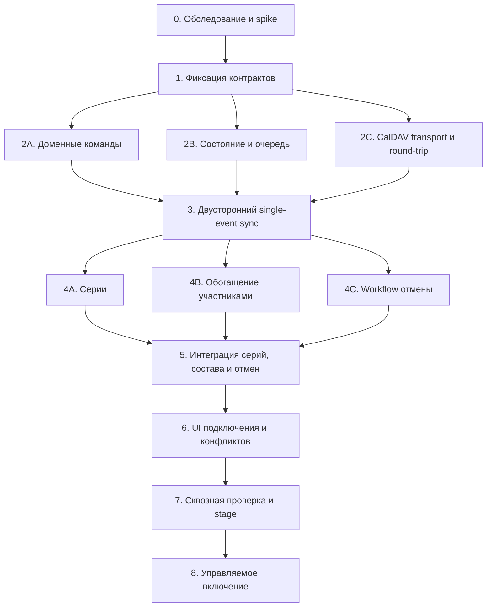

# План реализации Яндекс / CalDAV по стадиям и задачам субагентов

Дата: 17 октября 2026 года. Статус: реализация начата. Актуальная архитектура — отдельный сервис `services/katfit-calendar-sync`; официальный образ и ядро Twenty остаются без изменений. Требования к concurrency, сериям и безопасной отмене сохраняются.

Основной контракт: [техническая спецификация](studio-yandex-caldav-implementation.ru.md). Продуктовый контекст: [архитектура](studio-external-calendar-sync.ru.md).

## 1. Правила выполнения

- Координатор запускает только задачи с выполненными зависимостями, проверяет результаты и интегрирует изменения. Перед каждым запуском читаются актуальные AGENTS.md / CLAUDE.md и спецификация.
- Стадия закрывается проверяемым результатом, а не сообщением «код готов». В таблице прогресса фиксируются commit / diff, проверки, ограничения и следующий разрешённый шаг.
- Не запускать одновременно агентов с правом записи в одинаковые файлы. Общие types, module registration, миграции и lockfile имеют одного владельца — координатора или явно назначенного агента.
- Общая рабочая директория не изолирует изменения агентов. Для параллельных изменений назначать непересекающиеся файлы; отдельные worktrees нужны только при обоснованной необходимости. Параллельные patch разных веток интегрируются последовательно.
- Каждый агент получает один ограниченный результат, список разрешённых путей и явно запрещённые изменения. Изменения за пределами задания согласуются с координатором.
- Новые credentials, реальные CRM-данные и рабочий календарь не используются в fixtures и отчётах. До live spike можно подготовить полностью автономный DAV stub и тестовые сценарии.
- Live spike, schema apply, deploy и включение workspace-флага — отдельные явно обозначенные действия. Этот план не означает их выполнение.
- Полноценный выпуск включает серии, список участников и безопасную отмену. Одиночный CRUD — промежуточный технический результат.

## 2. Зависимости и параллельность



Не более трёх исполнителей одновременно плюс координатор. После стадии 1 UI-агент может отдельно подготовить mockup / контрактные fixtures без регистрации production UI; окончательное подключение — стадия 6. Если участки кода пересекаются, задачи выполняются последовательно.

## 3. Стадия 0 — обследование и проверка предположений

**Цель:** снять риски, которые могут изменить архитектуру до написания основной реализации.

Две независимые исследовательские задачи, без production-изменений:

### 0A. Домен и API-транспорт

- Проверить создание, перенос, отмену и существующие источники изменения ClassSession.
- Перечислить обычные пакетные, SPLIT и PAYG бронирования, их статусы, резервирование, возврат и аудит.
- Найти механизм workspace-scoped HTTP/API-вызова logic functions из внешнего сервиса и конкретные точки подключения Gelios / KateFitNotes.
- Доказать путь атомарной revision / compare-and-set; определить, как исключить обход через стандартное редактирование Twenty.
- Проверить границы транзакций и восстановление потерянного ответа команды.

Результат: `Docs/studio-yandex-caldav-discovery-domain.ru.md` с точными путями, пробелами реализации и выбранной стратегией concurrency. Нельзя объявлять проверку updatedAt атомарной защитой.

### 0B. CalDAV и тестовый сервер

- Проверить установленные версии tsdav / iCalendar-библиотек и поддержку чтения/записи ресурса без потери неизвестных полей.
- Реализовать собственное CALDAV-only подключение и шифрование credentials; ConnectedAccount Twenty не использовать.
- Подготовить DAV stub: discovery, multi-status, ETag, 412, partial failure, invalid token, lost response.
- На отдельно предоставленном тестовом календаре проверить conditional PUT / DELETE, series exceptions, EXDATE, UID / href, сохранение описания и отсутствие неожиданных приглашений.
- Зафиксировать поддержанные capabilities Яндекса отдельно от возможностей стандарта. Если доступа нет, live-проверки обозначить NOT_RUN, продолжить автономную подготовку.

Результат: `Docs/studio-yandex-caldav-discovery-transport.ru.md` и автономные fixtures без секретов.

**Ворота 0:** выбран реализуемый командный путь и понятны библиотечные ограничения. Непроверенные live capabilities допускают разработку со stub, но блокируют последующее включение в рабочем календаре.

## 4. Стадия 1 — контракт и владельцы файлов

Владелец: координатор после результатов 0A / 0B.

- Уточнить техническую спецификацию по результатам исследования, не менять пользовательские требования молча.
- Зафиксировать нормализованный snapshot, interval как единое поле, recurrenceKey, metadata resolution, participant projection и версии.
- Зафиксировать DTO команд, gateway identity, domain revision и коды ошибок.
- Зафиксировать state machine, уникальные ключи, inbox / outbox protocol, fencing и cursor commit.
- Утвердить предложенную схему таблиц с реальными repository / migration conventions.
- Назначить точные пути каждому агенту; создать минимальные общие types/ports и fixtures, необходимые параллельным задачам.

Результат: раздел «Контракты стадии 1» в discovery-документах либо отдельный `Docs/studio-yandex-caldav-contracts.ru.md`; общий код контрактов без заглушек, притворяющихся работающей интеграцией.

**Ворота 1:** исполнители 2A / 2B / 2C могут независимо реализовать согласованные ports, не угадывая интерфейсы друг друга. Все общие файлы имеют одного владельца.

## 5. Стадия 2 — три независимых основания

### 2A. Доменные команды и контроль конкуренции

Область: назначенные handlers / logic routes `katfit-studio` и поддерживаемый API-командный путь приложения, выбранный на стадии 1; ядро Twenty не меняется. Общие schema registration и миграции передаются координатору.

Задачи:

1. Ограниченный CreateSession gateway: будущие занятия, без участников, COMPLETED и списаний из календарного payload.
2. RescheduleSession: начало и окончание вместе, expectedRevision, закрытые занятия, аудит.
3. Интерфейс CancelSession и план отмены по типам бронирования; orchestration — задача 4C.
4. Идемпотентность, восстановление после потери ответа и атомарная защита от конкурирующего UI / worker.
5. Durable intent либо recoverable command protocol; явный учёт всех путей изменения управляемых полей.

Проверки: повтор создания и переноса, stale revision, одновременные UI/worker, восстановление аудита; отсутствие бронирований и CONSUME при календарном создании.

**Готово:** команды работают независимо от CalDAV; доказан concurrency guard, обходные UI-пути закрыты или включены в него.

### 2B. Служебная БД, очередь и исполнение

Область: repositories / entities / jobs нового внешнего сервиса; миграции — один назначенный владелец.

Задачи:

1. Connection, resource, binding, inbox, operation, conflict и ограничения из контракта стадии 1.
2. Сохранение ingestion batch и cursor; частичная ошибка не продвигает cursor.
3. Dispatcher, retry/backoff, дедупликация, lease + fencing, superseded operations.
4. Состояние подключения, backlog, last successful fetch отдельно от полного применения.
5. Pause / resume / disconnect, остановка новых операций и восстановление backlog.

Проверки с БД: уникальные ключи, два worker, stale lease, рестарт между commit и публикацией job, cursor после partial batch.

**Готово:** работа восстанавливается из долговечного состояния без зависимости от единственного события очереди.

### 2C. CalDAV transport и iCalendar round-trip

Область: выделенные новые transport / serializer файлы; изменение существующего generic importer только при обосновании и с регрессиями.

Задачи:

1. Подключение, discovery, проверка выбранной коллекции и encrypted credentials.
2. Явные типизированные результаты success / partial / error вместо пустого массива при сбое.
3. Чтение сырого VCALENDAR, ETag, delta и fallback inventory.
4. Conditional create/update/delete; детерминированный UID / href и проверка результата после timeout.
5. Сохранение неизвестных свойств, VTIMEZONE, DESCRIPTION, alarms и участников при round-trip.
6. Безопасные discovered href / redirects, запрет утечки Authorization, лимиты XML / ICS и повторений.

Проверки: DAV stub, 412, повтор PUT после потерянного ответа, partial multi-status, смена href, parser error и сохранение неизвестных полей.

**Готово:** адаптер возвращает достоверное состояние и условно пишет ресурс; не вызывает команды студии и не содержит бизнес-решений об отмене.

**Ворота 2:** координатор объединяет 2A / 2B / 2C, выполняет совместимый typecheck и контрактные тесты. Отдельные зелёные тесты агентов не заменяют проверку объединённого результата.

## 6. Стадия 3 — двусторонняя синхронизация одиночных событий

Владелец: один интеграционный агент после ворот 2.

1. Initial preview: create / link / missing metadata / unsupported / conflict.
2. Активация с проверкой версии preview, явное связывание существующих тренировок.
3. Inbound: inbox → metadata → command → binding → baseSnapshot.
4. Outbound: durable intent → current state → conditional write → подтверждение версии.
5. Three-way merge, interval conflict, own-write echo suppression.
6. Polling и ручная sync job, восстановление после отзыва доступа и invalid token.
7. Сверка изменений CRM вне gateway без создания циклов и финансовых эффектов.

На этом этапе RRULE явно отклоняется как unsupported. Продуктовое включение запрещено.

**Ворота 3:** со stub и test DB пройден цикл Яндекс → CRM → Яндекс, обратный цикл, потерянный ответ, рестарт и конкурирующий перенос. В каждом сценарии одна тренировка, одна связь и одно внешнее событие.

## 7. Стадия 4 — три расширения

После single-event ядра можно запускать 4A / 4B / 4C параллельно только в выделенных подпапках и согласованных ports. Общий sync orchestrator остаётся у координатора.

### 4A. Серии и исключения

- Материализация горизонта, UID + RECURRENCE-ID, RRULE / RDATE / EXDATE и timezone.
- Перенос и отмена отдельного экземпляра через изменение целого ресурса с ETag.
- Ежедневное продление горизонта без дублей.
- Смена master, удаление instance, разделение серии и неподдержанный RANGE: безопасное ручное решение.
- Предпросмотр массовых изменений, сохранение закрытых занятий и клиентских связей.

**Готово:** перенос экземпляра не меняет его идентичность; изменение master не теряет записи и не вызывает необоснованную массовую отмену.

### 4B. Имена участников и обогащение

- Общий participant reader для обычных, SPLIT и PAYG бронирований.
- Имя и фамилия как в CRM, дедупликация по personId, стабильный порядок, обработка пустого имени.
- Генерируемый блок DESCRIPTION с количеством мест и авторизованной ссылкой на занятие.
- Изменение бронирования и имени клиента → обновление актуальной проекции; coalescing и periodic repair.
- Раздельные participantProjectionHash и schedule snapshot; ручная правка списка не создаёт бронирование.
- Для серии вернуть descriptor нужного instance; запись exception выполняет общий recurrence writer, а не второй независимый serializer.

**Готово:** после записи/отмены обновляются имена в том же событии; комментарии сохранены; ошибка чтения участников не очищает список; ATTENDEE не добавляются.

### 4C. Отмена и восстановление бронирований

- План воздействия и CANCELLATION_REVIEW при наличии участников.
- Resumable workflow обычных, SPLIT и PAYG отмен с доменными правилами и ключами каждого шага.
- При неизвестном типе — явная блокировка, без частично скрытого пропуска.
- Не воссоздавать удалённое событие до решения review.
- Удаление master и конкретного instance передаются recurrence port; не удалять весь ресурс ради одного занятия.

**Готово:** сбой между двумя возвратами резервов восстанавливается без повторного возврата и потери аудита; недоступный календарь не запускает отмену.

## 8. Стадия 5 — совместная интеграция

Владелец: координатор / один интеграционный агент после завершения 4A / 4B / 4C.

- Подключить recurrence writer, participant projection и cancellation workflow к одному operation pipeline.
- Убедиться, что ETag блокирует гонки изменений разных экземпляров одного ресурса.
- Применять актуальное состояние при retry, не отправлять устаревший список участников.
- Проверить закрытие занятия, изменение имени клиента, перенос instance и отмену в конкурентных комбинациях.
- Согласовать журнал и UI-состояния для частично завершённого cancellation workflow.

**Ворота 5:** одна серия с разными участниками на разные даты; параллельные запись, перенос, комментарий в Яндексе и retry сохраняют правильный состав, время, комментарий и историю.

## 9. Стадия 6 — API и интерфейс

Две задачи после стабилизации интеграции: backend API и UI в разных файлах. DTO и маршруты из стадии 1, изменения контракта — через координатора.

### 6A. API внешнего сервиса

Discover draft с TTL, выбор календаря, preview/activate, status, sync, pause/resume, credential rotation, конфликты и disconnect. Роли и workspace isolation обязательны. Любая мутация принимает idempotency / observed versions там, где это предусмотрено спецификацией.

### 6B. CRM / Gelios

Форма подключения Яндекса, выбор календаря, defaults, preview и linking; статус/ошибки; review отмен; выбор решения конфликта. Deep link из календаря открывает конкретное занятие и запись клиента с обычной авторизацией. Имена видны в закрытом календаре; это явно указано на экране подключения.

**Ворота 6:** пользователь проходит подключение → preview → создание → запись клиента → обновление имён → перенос → конфликт → отмену → pause/resume. Другой workspace не получает доступ к подключению и операциям.

## 10. Стадия 7 — сквозные проверки и stage

Отдельный проверяющий агент может работать параллельно с исправлениями только read-only относительно реализации. Найденные дефекты возвращаются владельцу компонента; проверяющий не правит те же файлы одновременно с ним.

- Повторить acceptance matrix спецификации и failure injection из стадий 2–5 на объединённой версии.
- Пройти live-набор на отдельном Яндекс-календаре: реальное conditional write, refresh мобильного клиента, series exceptions, имена по экземплярам и комментарии.
- Проверить отсутствие неожиданных приглашений, секретов в ответах/логах, обхода workspace isolation и concurrency guard.
- Подготовить migration plan, katfit-studio metadata plan, список прав, rollout / rollback runbook и метрики.
- Применение на stage выполняется отдельным действием; зафиксировать результаты, не выдавать mock/stub за проверку Яндекса.

**Ворота 7:** все обязательные проверки PASS; NOT_RUN для live CalDAV или опасных concurrency-сценариев блокирует рабочее включение. Исправления проверяются целевыми регрессиями, без бесконечного повторения уже пройденного набора.

## 11. Стадия 8 — управляемое включение

1. Сохранить согласованные defaults и права закрытого календаря.
2. Включить feature flag только для выбранного workspace после готовности stage.
3. Выполнить preview и подтвердить карту существующих тренировок.
4. Активировать один календарь, наблюдать backlog, конфликты и возраст обновления.
5. Проверить создание с телефона, добавление клиента в CRM, обновление имени в описании и перенос с обеих сторон.
6. При необходимости pause/rollback: остановить отправку, сохранить связи и операции; возобновлять только после сверки.

**Готово:** рабочий цикл подтверждён, история и финансы согласованы, оператор понимает ошибки и порядок восстановления. Развёртывание и включение не входят автоматически в поручение отдельному разработчику.

## 12. Шаблон поручения субагенту

```text
Реализуй задачу <номер и название> из Docs/studio-yandex-caldav-implementation-plan.ru.md.
Прочитай AGENTS.md / CLAUDE.md, техническую спецификацию и контракты стадии 1.
Зависимости завершены: <подтверждённые результаты / commits / проверки>.
Разрешённые пути: <точный список файлов или подпапок>.
Общие файлы, которые нельзя менять: <список>.
Реализуй: <конкретный результат и ограничения>.
Проверь: <поведенческие сценарии и команды из реальных package scripts>.
Не выполняй deploy, schema apply и изменения рабочего календаря.
Не расширяй scope и не меняй общий контракт без сообщения координатору.
В отчёте укажи: изменённые файлы, поведение, проверки с результатами,
непроверенные предположения, необходимые integration hooks и блокеры.
Не объявляй стадию завершённой, если её критерии ещё не выполнены.
```

Координатор перед запуском подставляет точные пути. Предлагаемое имя модуля из спецификации не является разрешением редактировать весь backend. Агент не получает задачу «реализовать всё» под видом одного этапа.

## 13. Проверки и команды

Использовать реальные scripts пакета, не предполагать, что SDK-приложение запускается Jest так же, как twenty-server.

- `katfit-studio`: из `packages/twenty-apps/internal/katfit-studio` — `yarn test:unit`, `yarn typecheck`, `yarn lint`.
- Сервис: из `services/katfit-calendar-sync` — `npm ci`, `npm run typecheck`, `npm test`, `npm run build`. DB-тесты требуют отдельного тестового socket; см. README сервиса.
- После правок twenty-shared или переключения ветки — `npx nx build twenty-shared --skip-nx-cache` перед проверкой зависимых пакетов.
- Интеграционные DB-проверки запускаются на отдельной тестовой БД; команды reset не выполняются против рабочего подключения.
- Миграции сервиса: `npm run migrate` только против собственной БД; core upgrade pipeline Twenty не используется. Translation catalogs не включать в diff.
- После объединения параллельных изменений координатор проверяет общий diff, typecheck и затронутые интеграционные сценарии.

## 14. Реестр прогресса

Обновляется координатором; NOT_STARTED не означает скрытого запуска агентов.

| Задача | Зависит от | Статус | Подтверждение |
| --- | --- | --- | --- |
| 0A. Домен | — | IN_PROGRESS | [Начальные наблюдения](studio-yandex-caldav-discovery-notes.ru.md); concurrency strategy не выбрана |
| 0B. Transport spike | — | IN_PROGRESS | [Наблюдения и реализация](studio-yandex-caldav-discovery-notes.ru.md); управляемые HTTP/XML fixtures проверены, live-проверки ещё не выполнены |
| 1. Контракты | 0A, 0B | NOT_STARTED | — |
| 2A. Команды | 1 | NOT_STARTED | — |
| 2B. Состояние / очередь | 1 | IN_PROGRESS | Операции, credentials, raw resources и транзакционный inbox; readGeneration, lease и read-only poller; 30 PostgreSQL-тестов. Binding, импорт в CRM и обработчик исходящих операций ещё не готовы; ворота 1–2 не закрыты |
| 2C. Transport | 1 | IN_PROGRESS | Независимые authenticated transport, DNS guard, discovery CLI, conditional writer и тесты; полный REPORT inventory готов; delta sync-token, редактирование VCALENDAR round-trip и live ещё не готовы |
| 3. Single-event sync | 2A, 2B, 2C | NOT_STARTED | — |
| 4A. Серии | 3 | NOT_STARTED | — |
| 4B. Участники | 3 | NOT_STARTED | — |
| 4C. Отмена | 3 | NOT_STARTED | — |
| 5. Интеграция | 4A, 4B, 4C | NOT_STARTED | — |
| 6A. API | 5 | NOT_STARTED | — |
| 6B. UI | 5 | NOT_STARTED | — |
| 7. Проверка / stage | 6A, 6B | NOT_STARTED | — |
| 8. Включение | 7 | NOT_STARTED | — |

### Промежуточный результат: preview одиночного события

В отдельном сервисе реализованы parseCalendarEvent / prepareCalendarSession и операторский CLI preview локального ICS. Нормализуются UTC/IANA-даты, сохраняется UID; неоднозначные DST, серии, отмены и невалидные метаданные требуют review. Ключ создания стабилен при переносах и зависит от workspace/connection/UID. Генерируемый список участников исключается из разбора метаданных.

Добавлен read-only поиск через публичный REST classSessions по recordingKey: контроль схемы, точного ключа, дублей, пагинации, timeout и размера ответа. Preview различает отсутствие, существующее занятие и ошибку; ничего не записывает. Поиск пока проверен управляемыми ответами, а не живой CRM. Inbox worker, восстановление связей после переподключения, обработка существующих прошедших занятий и атомарные мутации остаются открытыми. Полные этапы импорта и двустороннего обмена не завершены.

### Промежуточный результат: фоновый CalDAV inbox preview

Добавлены четвёртая миграция собственной схемы, calendarImportPreview и calendarCurrentImportPreview, фоновый worker под CALENDAR_PREVIEW_ENABLED (default false). Он использует исходные данные из CalDAV inbox без ICS-файлов, сохраняет READY/NEEDS_REVIEW/SUPERSEDED и не меняет CRM/календарь. История связана с inboxId/configurationVersion, актуальное представление дополнительно проверяет resourceVersion, присутствие ресурса и состояние подключения. Inbox не помечается APPLIED. Подготовка транзакционна, использует блокировку подключения в том же порядке, что ingestion; одновременные workers безопасны.

Подтверждены 221 тест, включая 38 PostgreSQL integration checks без пропусков; сборка, типизация, Compose config, применение четырёх миграций и повторный запуск, health и SIGTERM с включённым preview. Реальные Яндекс/CRM credentials не использовались. Следующие работы: сохранённые связи UID↔classSession, CRM lookup для inbox, операторский review/defaults flow и атомарные доменные команды. Автоматические мутации остаются выключены.

### Промежуточный результат: CRM lookup worker и UID-связи

В отдельном сервисе добавлены пятая миграция, calendarSessionLink и calendarCrmReconciliation. Фоновый read-only worker включается CALENDAR_CRM_LOOKUP_ENABLED=false→true и строго привязан к операторским workspace/connection и API-токену. Lookup по recordingKey выполняется вне транзакции, ответ сохраняется с повторной проверкой актуального preview/configurationVersion/resourceVersion и lease fencing. Сохраняются LINKED/CREATE_CANDIDATE/NEEDS_REVIEW; временные ошибки повторяются с задержкой. Автоматических записей в CRM/CalDAV нет.

Подтверждены 246 тестов без пропусков, включая PostgreSQL, новая миграция up/down, конкуренция, устаревшие ответы, неправильный workspace, неизменность UID при переносе, смена CRM identity, отсутствие связанного занятия и запрет двух UID на одну тренировку. Проверены типы, сборка, Compose config, применение пяти миграций/повтор и health/SIGTERM включённого worker. Реальные credentials не использовались.

Остаются: полный контроль duplicate UID среди сырых ресурсов, восстановление связи при переносе href/переподключении, lookup существующих прошедших/неподдерживаемых событий, операторский requeue/review, CRM-only polling и подтверждённая база merge. observedSession — только наблюдённый CRM snapshot. CREATE_CANDIDATE и LINKED не разрешают автоматически менять расписание; перед записью нужны свежая проверка и атомарные доменные команды.

### Промежуточный результат: неизменяемая команда создания

Шестая миграция добавляет calendarSessionCreateIntent. Opt-in CALENDAR_CREATE_PREPARATION_ENABLED сохраняет команду PLANNED с пустыми participants и прежним ключом для актуальных READY/CREATE_CANDIDATE; payload не заменяется при новой версии UID. Проверяются UID всех присутствующих сырых ресурсов, включая неготовые к импорту события. Добавлен sender публичной команды /s/studio/sessions/create с жёсткой схемой и unconfirmed для неизвестного результата; он не подключён к фоновому исполнению и реальных POST не было.

В коде katfit-studio подтверждены unique recordingKey и idempotency flow, но создание с журналом не атомарно. Перед включением executor требуются неизменяемый повтор, сверка SESSION_CREATED, повторная проверка source/lease/state и проверка установленного индекса на стенде. REST lookup без журнала недостаточен для подтверждения завершения команды.

Полный тест выявил существовавшую гонку claimNext общей очереди: advisory lock внутри одного SQL допускал устаревший snapshot следующего claimant. Исправлено отдельным запросом блокировки перед claim в транзакции; конкурентный тест усилен до 20 раундов. Пройдены 266 тестов без пропусков, типизация, сборка, Compose config, шесть миграций/повтор и health/SIGTERM с включённой подготовкой. Ядро Twenty и его образ не менялись.

### Промежуточный результат: сверка журнала и recovery flow создания

Добавлены read-only inspector занятия и SESSION_CREATED через публичные API, операторская команда inspect-creation по сохранённому intent и модуль recoverCalendarSessionCreation. Он сначала сверяет занятие/журнал, повторяет только ту же frozen-команду после callback guard и подтверждает результат повторной сверкой. Пропавшая/изменённая известная CRM identity, неверный журнал, изменение параметров без журнала и отсутствие разрешения guard останавливают POST. Успешного ответа POST без журнала недостаточно.

Модуль recovery пока не включён в main/CLI-отправку. Нужны durable lease/attempt/proof для intents и проверка актуального CalDAV source, восстановление сохранённых известных ID, проверка установленного индекса и операторский ACTIVE flow. Lookup и POST не являются распределённым CAS. Изменения ядра не потребовались, миграций в этом шаге нет.

Пройдены 302 теста без пропусков, типизация и сборка. Операторский CLI проверен с реальными сервисными таблицами во временной БД и локальным mock API: два GET, подтверждение журнала, отсутствие изменений intent. Реальная CRM/Яндекс не затронуты.

### Промежуточный результат: durable creation execution и read-only recovery worker

Седьмая миграция добавляет calendarCreationExecution / calendarCreationAttempt: lease 120 секунд, fencing, отдельная история поколений, первая/последняя сверка, фиксация sendStartedAt до отправки, отдельный sendResult, известный CRM ID и итог. При перезапуске незавершённая попытка снова начинает со сверки; CONFIRMED без сохранённого соответствующего журнала запрещён.

CALENDAR_CREATION_RECOVERY_ENABLED (default false) подключает read-only worker в main, health и Compose. Он сохраняет сверки без POST. Внутренняя отправляющая ветка проверена только injected sender: ACTIVE, сохранённая предшествующая сверка, актуальный source/configurationVersion, frozen payload, последний снимок не старше 90 секунд, будущий старт и полная проверка UID. Production factory sender не создаёт и не принимает флаг отправки.

Пройдены 321 тест без пропусков, типизация, сборка и Compose config. Runtime smoke с временной PostgreSQL и локальным mock API подтвердил семь миграций/повтор, сохранение доказательства, health, SIGTERM и повторный запуск без повторных GET/POST для CONFIRMED. Реальные credentials не использовались.

Остаются live CalDAV source guard перед отправкой, проверка deployed unique index/команды, операторский ACTIVE/review flow, обработка поздних результатов после смены конфигурации, финализация UID-связи/общей базы и конфликты. Ни lease, ни возраст локального снимка не дают распределённую атомарность с CRM. Автоматическая production отправка всё ещё отсутствует.

### Промежуточный результат: live CalDAV source guard

Восьмая миграция добавляет liveSourceCheck/liveSourceCheckedAt в attempt. Новый checkCalendarResource выполняет условный GET через существующий safe Yandex transport, проверяет сильный ETag, размер/тип ответа и SHA-256 с допуском только нормализации переводов строк REPORT/GET. Proof привязывается к resourceId/version, захваченным до запроса; смена ресурса, конфигурации или lease отвергает результат. beginSend требует свежий verified proof текущего поколения (10 секунд). Изменения/удаления отправляются на review, временная ошибка повторяется без POST.

CALENDAR_LIVE_SOURCE_CHECK_ENABLED (default false) требует recovery и encryption key. Production режим остаётся read-only: при absent/incomplete он может проверить Яндекс и сохранить proof, но sender не подключён. Проверка ресурса не подтверждает глобальную уникальность UID в неопросившейся коллекции и не даёт распределённой атомарности между GET/POST.

Пройдены 353 теста без пропусков, типизация, сборка, Compose config; проверены восемь миграций/повтор, health/SIGTERM режима live-check на пустой временной БД без внешних запросов. Интеграционные проверки включают смену resourceVersion во время GET, точный conditional request, encrypted credentials→proof, истёкший proof, changed/unavailable без POST. Настоящие аккаунты не затронуты. Дальше: capability check CRM и управляемый ACTIVE/review flow, включение production sender, финализация создания и двусторонние обновления.

### Промежуточный результат: capability check и управляемое включение создания

Девятая миграция добавляет calendarActivation и capability proof в attempt. Новый check-crm проверяет metadata workspace/объектов/полей/одноколоночного unique recordingKey index/HTTP-команды одного приложения и REST read probes без создания тестовой тренировки. Проверка привязана к origin/workspace/token fingerprint; это metadata-контракт, не проверка поведения обработчика или физического индекса CRM. Публичные запросы сверены с локальными resolvers/DTO, imports ядра отсутствуют.

Операторский activate заново проверяет capabilities и атомарно переводит PREVIEW→ACTIVE ожидаемой версии, сохраняя receipt и frozen payload. Текущая configurationVersion не повышается: подтверждается подготовленная версия. Новый CALENDAR_CREATE_SEND_ENABLED (default false) требует recovery/live-check/key, ACTIVE и свежих runtime capabilities, совпадающих с receipt. Затем выполняются live CalDAV guard и beginSend; перед POST требуется минимум 50 секунд lease. Production sender подключён только под этими условиями. PREVIEW остаётся read-only.

Добавлен pause CLI без API credentials/encryption key; он повышает configurationVersion и инвалидирует activation/proofs. Уже отправленный HTTP-запрос не отменяется. Возобновление после PAUSED и review/requeue flow ещё нужны. CONFIRMED пока сохраняет known ID/proof, но не финализирует UID link/общую merge base и не обогащает календарь.

Пройдены 391 тест без пропусков, типизация, сборка, Compose config. Сквозной production-configured worker на mock API подтвердил activation→fresh capabilities→live GET→один POST→audit confirmation без повторного POST. Runtime smoke проверил девять миграций/повтор, check-crm/activate/repeat/pause отдельными Node-процессами и health/SIGTERM send-mode с PAUSED подключением без create-запросов. Реальные accounts не использовались; в реальном окружении отправка не включена. Следующие этапы: финализация создания/UID-связи, operator review/resume и двусторонние изменения.

### Промежуточный результат: финализация создания и обратное обогащение CalDAV

Десятая миграция добавляет commonBase/version/ETag к link, durable backfill finalization и calendarDescriptionRefresh. Подтверждённое создание со snapshot атомарно связывает UID/classSessionId, инициализирует базу только при совпадении source/command/CRM, отмечает соответствующий inbox APPLIED и reconciliation LINKED, создаёт refresh job. При расхождении сохраняется идентичность без ложной общей базы и finalization требует review. Старые CONFIRMED без snapshot восстанавливаются отдельным read-only worker.

CALENDAR_DESCRIPTION_PREPARATION_ENABLED готовит immutable outbox по публичной GraphQL query бронирований/имён; ошибки/неполные ответы не очищают roster, одноимённые люди различаются по ID. CALENDAR_EXPORT_SEND_ENABLED (default false) разрешает только при ACTIVE/binding/lease и свежих CRM reads GET→проверка допустимого patch→If-Match PUT→GET. Меняются DESCRIPTION и X-KATFIT-SESSION-ID, сохраняются UID/время/название/notes/attendees/alarms. Потерянный ответ сверяется без слепого повторного PUT; правка источника вызывает CONFLICT. Поддержаны opaque/encoded resource href без обязательного расширения .ics с сохранением защиты прямого дочернего ресурса.

Пройдены 437 тестов без пропусков, типизация, сборка, Compose config. Runtime smoke подтвердил десять миграций/повтор и health/SIGTERM finalizer/preparer/publisher на пустой временной БД без внешних запросов. Интеграционные проверки покрывают публикацию, lost-response recovery без второго PUT, пользовательские правки, stale roster, backfill и атомарные откаты link/inbox/outbox. Реальные credentials и записи не использовались.

Остаются полноценные переносы/отмены и CRM-only schedule polling, серии, operator review/resume и ручное сопоставление старых занятий. Новый scope завершает создание+обогащение одиночных будущих событий, не весь двусторонний CRUD; synchronizationEnabled остаётся false.

### Промежуточный этап: подготовка двусторонних переносов

Добавлены `planCalendarSchedule` и `renderCalendarSchedule` во внешнем сервисе.
План сравнивает общую базу, текущую CRM и событие; объединяет независимые
изменения названия и интервала целиком. Конфликт, смена идентичности, формата,
вместимости, завершённое или начавшееся занятие требуют разбора.
Рендер сохраняет UID, описание, участников и напоминания, проверяет обратное
чтение времени и отказывается от неоднозначных DST-интервалов.

Автоматический перенос ещё не включён. Следующая обязательная часть — атомарное
условное обновление расписания через публичный API CRM, затем сохранённое
намерение переноса, восстановление после неопределённого ответа и продвижение
общей базы только после подтверждения обеих сторон. Существующий UI использует
`updateClassSession` по ID; отдельное чтение перед таким вызовом не защищает от
конкурентной правки. Ядро Twenty и приложение CRM на этом этапе не менялись.

### Промежуточный этап: условное обновление расписания CRM

Реализованы `createCalendarScheduleUpdater` и `recoverCalendarScheduleUpdate`.
Публичный GraphQL `updateClassSessions` получает фильтр на ID, recordingKey,
предыдущие название/время/формат/вместимость/статус; меняются только название и
время. Локальные CommonUpdateManyQueryRunnerService → runFilteredMutation →
WorkspaceRepository.runMutation → SQL buildMutationStatement сохраняют фильтр
в UPDATE WHERE. При несовпадении возвращается конфликт; отдельный handler и
изменение ядра не нужны. На установленном официальном образе это ещё необходимо
проверить стендовым тестом.

Восстановление читает состояние перед отправкой и после ответа, распознаёт уже
достигнутую цель, не отправляет поверх правки пользователя и не доверяет одному
HTTP-успеху. Подтверждается наблюдаемое состояние, а не авторство прошлой операции.
Команда копируется и валидируется до await. Сохранение команды на диск/в БД и
подключение к воркеру пока не реализованы. Следующие части: неизменяемое намерение
с lease/fencing, проверка актуального CalDAV перед CRM-записью, условный PUT и
продвижение commonBase после проверки обеих сторон. Ядро и CRM-приложение не менялись.

### Этап: сохранённый цикл переносов CRM ↔ CalDAV

Завершены подготовка неизменяемого намерения в общей очереди, отдельные фоновые
воркеры подготовки/отправки и их подключение к main, health, Compose и .env.example.
Миграция 11 меняет только calendar_sync. Новые флаги по умолчанию выключены.

Цикл проверяет актуальный CalDAV перед условным CRM UPDATE, затем CRM перед
условным PUT; подтверждает обе стороны и ждёт снимка poller перед транзакционным
продвижением commonBase. Потеря ответов, перезапуск, пауза, конкуренция и откат
сохранения базы покрыты тестами на отдельной PostgreSQL с mock API.

Остаются: операторский просмотр/разрешение конфликтов и безопасный повторный запуск,
отмены с сохранением записей/истории, серии, стендовая проверка реальной версии API
и Яндекса. Автоматического отката частично выполненного переноса нет.

Проверка этапа: 484 теста / 35 наборов прошли без пропусков с временной PostgreSQL;
типизация, сборка и Compose config успешны. Runtime smoke подтвердил 11 миграций,
повторный запуск без новых миграций, health и graceful shutdown с обоими schedule
флагами на пустой временной БД. Внешние аккаунты и записи не использовались.

### Этап: операторский разбор конфликтов расписания

Добавлены list / inspect / resolve в локальной CLI review-schedule. Оператор
видит общую базу и текущее расписание обеих сторон, выбирает CRM или календарь
по двухминутному токену снимка. Повторное чтение и транзакционная проверка не дают
применить устаревшее решение. Новое неизменяемое намерение и снятие блокировки
связи сохраняются вместе; прежний конфликт остаётся в истории. Идемпотентный
повтор возвращает ту же операцию; работающий обработчик не вытесняется.

496 тестов / 35 наборов прошли без пропусков с временной PostgreSQL; типизация
и сборка успешны. Проверены обе стороны выбора, новые правки, срок токена,
конкурирующие решения, scope, пауза, сохранение истории и откат транзакции.
Нет изменений ядра, новой миграции, реальных внешних записей или включения флагов.

Остались отдельными задачами: UI/RBAC/автор решения, полный resume подключения,
отмены, серии и стендовая проверка совместимости реальных API.

### Этап: подтверждение удаления / отмены и запрос оператору

Добавлен отдельный фоновый read-only обработчик отмен под выключенным по умолчанию
CALENDAR_CANCELLATION_REVIEW_ENABLED. Миграция 12 — только собственная схема.
Два полных inventory + минутная задержка + GET 404/410 подтверждают отсутствие;
явный CANCELLED подтверждается актуальным телом/ETag. Перемещённый UID, ошибки
доступа, неполные ответы и серии требуют разбора. Снимок бронирований сохраняет
признаки финансового влияния; ни одной CRM/CalDAV мутации отмены не выполняется.

Сохранение запроса и блокировка расписания атомарны, новые версии не затирают старую
историю, повторное появление отменяет прежний запрос без удаления записи.
CLI review-cancellations показывает очередь оператору.

529 тестов / 38 наборов прошли с временной PostgreSQL без пропусков; типизация
успешна. Покрыты задержка, повторный снимок, GET-проверка, перенос href, повторное
появление, ошибки чтения, блокировки, устаревший результат и откат транзакции.

Исполнение отмены всего занятия остаётся отдельной задачей: нужна доменная команда
с согласованной обработкой броней/резервов/оплат и защитой от параллельной записи.
Текущий UI выполняет несколько отдельных команд; его нельзя безопасно копировать
в автоматический worker. Пока отмены выполняет оператор штатными средствами CRM.

### Этап: наблюдение ручной отмены и сохранение истории броней

Добавлены исходные/накопленные ID броней, журнал наблюдений и отметка
CRM_CANCELLED_OBSERVED для штатно отменённых пустых занятий. Поздняя бронь или
исчезнувшая замеченная запись возвращают запрос на разбор; финансовые случаи
не закрываются по одним флагам бронирований. CLI умеет показывать историю.
Миграция 13 затрагивает только calendar_sync.

Подтверждено архитектурное ограничение автоисполнения: отдельные CRM writers
проверяют статус до создания брони; внешний mutex не исключает такую гонку.
В studio-cancellation-execution-contract.ru.md зафиксированы затрагиваемые пути,
обязательные гарантии общего gateway и тесты до включения мутаций. Команда
автоотмены ещё не реализована; ядро и katfit-studio на этом этапе не менялись.

Проверка этапа: 552 теста / 39 наборов прошли с PostgreSQL без пропусков; типизация,
сборка, Compose config и diff check успешны. Runtime smoke проверил 13 миграций,
повтор без новых миграций, собранную CLI list/history, health и graceful shutdown
на пустой временной БД. Реальные аккаунты и внешние записи не использовались.

### Этап: первая основа общего gateway в katfit-studio

Впервые в этой ветке добавлена метадата пользовательского CRM-приложения:
nullable TEXT classSession.mutationLock. Ядро Twenty не меняется; официальный
образ остаётся применим. Обновление приложения на рабочей CRM не выполнялось.

Helper acquire/inspect/release использует условный публичный updateClassSessions,
уникального владельца каждого запуска и проверку потерянного ответа чтением.
Нет автоистечения, перехвата по таймеру и повторного входа по бизнес-ключу.
Старый владелец не может освободить новую блокировку. Полный контракт — в
studio-cancellation-execution-contract.ru.md.

Подключение существующих writers, сохранение полного intent/журнала, восстановление
исполнения, настройка прав против обхода и проверка установленного API ещё впереди.
Поэтому общая блокировка реальных бронирований и автоотмена пока не включены.

Проверка: все 98 unit-тестов katfit-studio прошли (13 новых проверок владения),
прямая типизация tsgo и lint затронутых исходников — без ошибок. Root package.json,
yarn.lock и twenty-server не изменялись. У приложения обновлены собственные
package.json/yarn.lock для прямого использования существующего @sniptt/guards.

### Этап: журнал исполнения и первый защищённый маршрут

Добавлены метаданные studioSessionOperation и уникального operationKey, helper
SessionOperationJournal и обёртка createGuardedRegularBooking. Маршрут обычной
записи клиента использует сохранённую команду, mutationLock и подтверждённые
переходы журнала. Успешный повтор не создаёт новую бронь; неопределённое выполнение
не запускается заново и не освобождает lock. Отказы до любого mutation-вызова
сохраняются как REJECTED и освобождают lock.

Переведён только HTTP-маршрут /studio/bookings/create. Остальные writers, пакетные
вызовы, роли и операторское восстановление — следующие части. Автоотмена остаётся
выключенной; ядро Twenty и официальный образ не меняются. На рабочую CRM обновление
приложения не устанавливалось.

110 unit-тестов приложения прошли, включая 12 новых сценариев журнала/обёртки;
типизация tsgo и lint затронутых файлов успешны. Проверки используют fake CRM API,
не доказывают атомарность/права установленного API.

SDK-проверка: `yarn twenty dev:build` успешно собрал manifest и 50 файлов приложения
с новым объектом/индексом. Это локальная сборка, не установка и не проверка реальных
API/прав. Генерируемый бинарный install-state не включён в изменения.

### Этап: split и pay-as-you-go через общий исполнитель

Из ordinary-обёртки выделен runBookingOperation. Добавлены адаптеры split и разовой
записи, два соответствующих HTTP-маршрута переведены на общий mutationLock/журнал.
Проверяются два различных bookingId пары либо bookingId/paymentId разовой записи.
Подтверждённые повторы не запускают тело повторно; частичные результаты требуют
разбора. Legacy duplicate без gateway-квитанции также требует сверки и не снимает
владельца автоматически.

Все 120 unit-тестов приложения прошли (10 новых сценариев вариантов), типизация
и lint затронутых файлов успешны. Тесты gateway используют fake API. Реального
обновления CRM не выполнялось, ядро не менялось. Дальше — пакетные участники,
проведение/отмены, восстановление, права и координация общих пакетов.

SDK-сборка `yarn twenty dev:build` прошла: manifest и 50 файлов приложения собраны
локально. Производственная CRM не изменялась. Генерируемый install-state исключён
из изменений; diff check успешен.

### Этап: пакетное создание участников

Публичный маршрут создания занятия включает coordinateSessionParticipants.
После подтверждения самого слота и SESSION_CREATED весь список выполняется под
одним BOOK/ATTEND владельцем и журналом session-participants. Вложенные обычные
записи и посещения используют тот же tracked client без повторного захвата lock.
Legacy-брони без квитанции и неполный исходный список не дополняются автоматически.
Пустой список CalDAV сохраняет прежнее поведение.

128 unit-тестов прошли, включая 8 новых сценариев с настоящими бизнес-обработчиками
поверх fake API: будущий/прошедший пакет, повторы, частичное выполнение, конкуренция
обычной записи, legacy, пустое создание и неверные участники. Типизация и lint
успешны. На реальную CRM изменения не устанавливались, ядро не менялось.

Далее: самостоятельное проведение/внесение посещений, отмены, разбор зависшего
владельца, прямые UI/API writers, права и совместное использование пакетов.

Локальная SDK-сборка `yarn twenty dev:build` успешно собрала manifest и 50 файлов.
Генерируемый install-state исключён; diff check успешен. Рабочие подключения и
внешние записи не использовались.

### Объединение: доменные команды и общее владение ресурсами

Публичные записи, пакетное добавление участников, посещения, отмены и подтверждение
разового платежа используют общий журнал занятия. Пакеты захватываются после
занятия в отсортированном порядке; при неизвестном результате владелец сохраняется.
Оформление покупки пакета/split имеет отдельную постоянную квитанцию на пакете:
успешный повтор не начисляет визиты и не пересчитывает уже изменившийся остаток.

UI расписания создаёт слот штатной командой с постоянным ключом попытки,
редактирует через snapshot-команду и отменяет всё занятие одной доменной командой.
Прямая мутация расписания из сервиса заменена тем же защищённым маршрутом.
Совпадение полей после сетевой ошибки само по себе не подтверждает исполнение:
требуется успешная квитанция и повторное чтение CRM.

Операторские локальные инструменты показывают журнал без токенов владельцев.
Освобождение возможно только для проверенной терминальной квитанции, известного
набора ресурсов и точного снимка; EXECUTING/NEEDS_REVIEW не снимаются по таймеру.
Инвентарь прав отделяет локальные декларации от непроверенных прав пользователей
и ключей установленной CRM.

Отмена из календаря получает отдельный явно запускаемый prepare/execute путь.
Фоновый детектор сохраняет запрос на разбор; новый путь не делает фоновые POST.
Финансово неоднозначные и проведённые занятия остаются на сверке. Нужны новая
миграция только calendar_sync и установка обновлённого пользовательского приложения.

Порядок тестовой установки, приёмки и отката описан в
[studio-calendar-release-checklist.ru.md](studio-calendar-release-checklist.ru.md).
Реальные права/условные update-запросы установленного API и Yandex live roundtrip
не подтверждаются unit-тестами и остаются выпускными воротами. Ядро Twenty и его
официальный образ не изменены. Серии повторяющихся событий исключены из версии 1.

Финальная локальная проверка объединённой реализации (17 октября 2026):
596 тестов сервиса / 43 набора с изолированной PostgreSQL без пропусков;
185 тестов приложения; обе типизации, lint приложения, сборка сервиса и SDK-сборка
приложения (54 файла) прошли. Runtime smoke на новой временной БД подтвердил
14 миграций, повтор без изменений, health и graceful shutdown. Compose config
и git diff --check успешны. Проверки не использовали рабочие аккаунты и не
подменяют приёмку установленного Twenty/Яндекса. Сборка Docker-образа в этом
прогоне не проверена; предыдущая попытка упиралась в получение metadata образа.

Дополнительный review закрыл stale-cancellation snapshot: подготовленная отмена
сохраняет расписание CRM, а команда проверяет его ещё раз под владением.
Поздний перенос занятия не отменяется прежним подтверждением. При кратковременной
занятости пакета до бизнес-записей подтверждённое освобождение ресурсов допускает
условный возврат CLAIMED → PREPARED и повтор с тем же ключом; неизвестное
освобождение оставляет операцию заблокированной.

### 18 октября 2026: первичный экспорт занятий CRM → Яндекс

Закрыт отсутствовавший сценарий: будущие занятия, сохранённые текущим UI с
`session-create:<UUID>`, получают детерминированное CalDAV-событие. Новые флаги
`CALENDAR_CRM_EXPORT_PREPARATION_ENABLED` / `CALENDAR_CRM_EXPORT_SEND_ENABLED`
отдельно разрешают подготовку/отправку. Добавлена миграция 15 собственной БД.

Источник читается с фильтрацией и пагинацией, точным UUID/recordingKey и проверкой
свободного mutationLock. Хранилище замораживает команду и связывает её с ACTIVE
активацией/configurationVersion/credentials binding. Перед PUT сохраняется отметка
отправки; после неё автоматический повтор PUT запрещён, но чтение того же ресурса
может подтвердить прежний результат. Чужой ресурс/изменённый источник требуют разбора.

После GET-подтверждения и полного polling точные данные/ETag/единственный UID
позволяют атомарно сохранить link/commonBase и отметить inbox обработанным.
Триггер миграции 15 подавляет обратное создание CRM-занятия ещё до появления link.
Последующие переносы и обогащение поддерживают CRM-origin recordingKey. Просроченная
операция старой конфигурации переводится на разбор и не блокирует новые записи.

Проверено: 678 тестов / 51 набор с изолированной PostgreSQL без пропусков,
типизация и сборка сервиса, Compose config. Сквозные тесты включают race polling
до finalization, последующие schedule/enrichment и потерянный ответ PUT с рестартом
без второго PUT. Runtime smoke подтвердил 15 миграций, повтор без изменений,
health/остановку с выключенным и включённым экспортом на пустой временной БД.
Рабочие CRM/Яндекс не изменялись; живая совместимость остаётся приёмкой стенда.
Старые занятия без поддерживаемого ключа не привязываются по названию.
