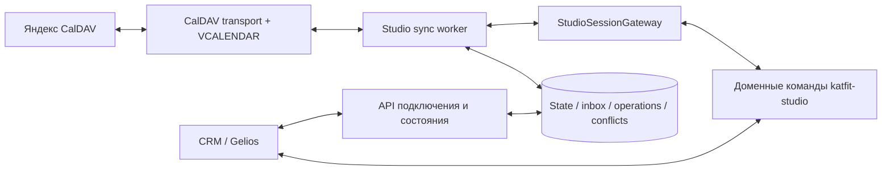

# Яндекс Календарь ↔ расписание студии: техническая спецификация

> Актуальный статус реализации: отдельный сервис и доменные команды `katfit-studio`
> реализованы локально; ядро и официальный образ Twenty не изменены. Живая установка
> и проверка прав ещё не выполнялись. Текущий порядок выпуска и ограничения:
> [проверка и выпуск](studio-calendar-release-checklist.ru.md),
> [операторский разбор](studio-gateway-operator-runbook.ru.md).
> Повторяющиеся серии исключены из версии 1; фоновая отправка отмен выключена.


Дата: 17 октября 2026 года. Статус: реализация начата, интеграция с реальным календарём ещё не включена. Актуальное решение — отдельный сервис `services/katfit-calendar-sync`, официальный образ Twenty без изменений. Разделы об исходниках Twenty описывают обследование существующего API, а не разрешение менять ядро.

Порядок выполнения, зависимости, задания субагентам и реестр прогресса: [пошаговый план реализации](studio-yandex-caldav-implementation-plan.ru.md).

## 1. Решение и границы

Провайдер текущей реализации — только Яндекс Календарь, протокол CalDAV, двусторонняя синхронизация с ClassSession CRM. Один выбранный календарь на студию в первом выпуске. Учетные данные: логин Яндекса и отдельный пароль приложения «Календарь». Начальный сервер — `https://caldav.yandex.ru`.

Google, OAuth Google, универсальная ICS-подписка, синхронизация между несколькими внешними календарями и автоматическая рассылка клиентам в этот объём не входят. Простой URL не заменяет логин и пароль приложения.

Расписание редактируется в обоих интерфейсах. Бронирования, посещения, абонементы и деньги управляются командами CRM. Внешние attendees никогда не создают бронирования. Наступление окончания события не завершает занятие и не списывает посещение.

Основа: [продуктовая архитектура](studio-external-calendar-sync.ru.md). Ниже конкретизируются технические решения; имена новых модулей, таблиц и маршрутов являются предлагаемыми, не существующим API.

## 2. Что подтверждено по исходникам

| Компонент | Путь относительно корня репозитория | Использование |
| --- | --- | --- |
| CalDAV-клиент на tsdav | `packages/twenty-server/src/modules/calendar/calendar-event-import-manager/drivers/caldav/services/caldav-client.service.ts` | Discovery, авторизация, SSRF-safe fetch |
| Получение клиента | `packages/twenty-server/src/modules/calendar/calendar-event-import-manager/drivers/caldav/providers/caldav-client.provider.ts` | ConnectedAccount и расшифровка протокольного пароля |
| Чтение коллекций | `packages/twenty-server/src/modules/calendar/calendar-event-import-manager/drivers/caldav/services/caldav-fetch-events.service.ts` | syncCollection либо fallback ctag / ETag |
| Cursor | `packages/twenty-server/src/modules/calendar/calendar-event-import-manager/drivers/caldav/types/caldav-sync-cursor.ts` | Карты sync tokens, ctags и ETags по календарям |
| Разбор iCalendar | `packages/twenty-server/src/modules/calendar/calendar-event-import-manager/drivers/caldav/utils/parse-ical-event.util.ts` | Справочный код, недостаточный контракт для обратной записи серий |
| Подключение протоколов | `packages/twenty-server/src/engine/core-modules/imap-smtp-caldav-connection/` | Проверить пригодность подключения только CALDAV без почты |
| Модель занятия | `packages/twenty-apps/internal/katfit-studio/src/objects/class-session.object.ts` | Время, формат, статус, capacity, recordingKey |
| Создание занятия | `packages/twenty-apps/internal/katfit-studio/src/logic-functions/handlers/create-class-session-handler.ts` | Идемпотентная доменная команда; поддерживает participants и прошлые посещения |
| HTTP-триггер создания | `packages/twenty-apps/internal/katfit-studio/src/logic-functions/studio-create-class-session.ts` | Авторизованный маршрут `/studio/sessions/create` |

Критические ограничения повторного использования:

- `CalDavClientProvider` Twenty использует ConnectedAccountProvider.IMAP_SMTP_CALDAV и connectionParameters.CALDAV. Это только результат обследования: внешний сервис не получает эти credentials и хранит собственное отдельное подключение.
- Текущий parser возвращает `[]` при ошибке и выдаёт плоские FetchedCalendarEvent. Для синхронизации тренировки это не доказательство пустого календаря: требуется явный результат ошибки, исходный VCALENDAR и идентичность экземпляров.
- `syncCalendar` ловит ошибку отдельного календаря и возвращает пустые изменения с прежним cursor. Новый сервис должен различать «нет изменений» и «сверка не выполнена», иначе UI покажет ложный успех.
- Существующая команда создания допускает participants, COMPLETED и attendanceReason. Календарный адаптер передаёт только разрешённые поля, `participants: []`, и не создаёт COMPLETED.
- Наличие SDK-команд не гарантирует общей транзакции для занятия, события аудита и записи очереди.

## 3. Размещение и ответственность

Оркестратор размещается в отдельном Node.js-сервисе `services/katfit-calendar-sync`. Он владеет polling, долговечной очередью, CalDAV-ресурсами, версиями и конфликтами. Сервис использует собственную PostgreSQL-базу и Docker-образ; Twenty server/worker продолжают использовать официальный образ. Импорты внутренних классов Twenty, доступ к его БД и core upgrade commands не используются.

Доменные команды остаются в штатном приложении `katfit-studio`: создать, перенести, отменить занятие. Внешний StudioSessionGateway вызывает разрешённые HTTP/API-команды с отдельным workspace-scoped ключом. Внутренний LogicFunctionExecutorService не вызывается. Ключ не передаётся в браузер. Изменения приложения устанавливаются штатным SDK-механизмом, без пересборки Twenty.

Gelios / KateFitNotes отображает состояние и вызывает backend через свой серверный слой с проверкой пользовательской роли. Его конкретные файлы определяются при реализации; существующие маршруты создания и бронирования не заменяются прямыми записью в таблицы.



Очередь принадлежит внешнему сервису: Postgres хранит долговечное состояние, собственный dispatcher выбирает задания. Механизм очередей Twenty и его Redis не требуются. Потеря сигнала запуска не теряет работу: следующий проход находит сохранённые незавершённые операции.

## 4. Подключение и проверка прав

1. Администратор вводит логин и пароль приложения; адрес Яндекса подставлен автоматически.
2. Сервис использует независимый CalDAV-клиент на tsdav с собственной SSRF-защитой, выполняет discovery principal / calendar-home / collections. Пути пользователя не конструируются из логина.
3. Возвращает список календарей с безопасным displayName, внутренним selection token и доступными привилегиями.
4. Пользователь выбирает выделенный календарь и настройки: timezone, формат, capacity, правила групп.
5. Backend проверяет принадлежность выбранного href результатам discovery и права записи. Если advertised privileges недостаточны для уверенного определения, подключение остаётся непроверенным до явной проверки на тестовом календаре.
6. Строится dry-run первоначального импорта, затем подтверждённый apply.

Пароль не сохраняется в объектах студии и не возвращается в ответе. Он хранится зашифрованным в собственной БД сервиса с отдельным ключом из защищённой конфигурации. Сервис не читает и не расшифровывает ConnectedAccount Twenty; IMAP/SMTP не подключаются. Шифрование и ротация credentials ещё предстоят реализации.

По документации Яндекса пароль приложения иногда начинает действовать через 2–3 часа; UI должен учитывать это при первичном подключении. Не проверять право записи созданием скрытого события в рабочем календаре без пользовательского действия.

## 5. Предлагаемая модель состояния

Служебные таблицы находятся только в собственной БД сервиса, схема `calendar_sync`, без бизнес-секретов в custom objects. Все записи содержат внешний workspaceId, UUID, createdAt, updatedAt. Ссылки на ClassSession / ClassGroup проверяются через API gateway. FK в core.workspace и другие таблицы Twenty запрещены; удаление/отключение workspace требует собственного offboarding flow.

| Таблица | Основные поля |
| --- | --- |
| studioCalendarConnection | credentialReference, calendarHref, calendarIdentity, state, timezone, defaults, configurationVersion, syncToken, inventoryGeneration, lastAttemptAt, lastSuccessfulSyncAt, nextPollAt |
| studioCalendarResource | connectionId, href, uid, etag, rawCalendarData, contentHash, remoteDeletedAt, observedGeneration |
| studioCalendarBinding | connectionId, resourceId, uid, recurrenceKey, classSessionId, baseSnapshot, localRevision, state, lastOperationId |
| studioCalendarInbox | connectionId, resourceIdentity, remoteVersion, payload, ingestionBatchId, state, errorCode |
| studioCalendarOperation | bindingId, direction, action, idempotencyKey, expectedLocalRevision, expectedRemoteEtag, desiredSnapshot, state, attempts, nextAttemptAt, leaseUntil, leaseGeneration |
| studioCalendarConflict | bindingId, conflictType, baseSnapshot, localSnapshot, remoteSnapshot, observedVersions, state, resolution |

Ограничения:

- UNIQUE(workspaceId, calendarIdentity) для активного подключения; исключить подключение одного календаря двумя competing accounts студии. Стабильность identity/href проверить в discovery spike.
- UNIQUE(connectionId, href) для ресурса.
- UNIQUE(connectionId, uid, recurrenceKey) для связи; одиночное событие получает recurrenceKey=`single`, не NULL.
- UNIQUE(connectionId, classSessionId) для связи в первом выпуске.
- UNIQUE(workspaceId, idempotencyKey) для операции; UNIQUE(connectionId, resourceIdentity, remoteVersion) для доставки. Для удаления без версии применяется идентификатор принятого ingestion batch.
- Индексы операций по state / nextAttemptAt и подключений по nextPollAt.

UID — семантическая идентичность; href — текущий адрес ресурса, который может измениться. При том же UID и новом href выполняется восстановление связи, а не новое создание. Два разных ресурса с одинаковым UID одновременно — конфликт источника.

recurrenceKey хранит исходный RECURRENCE-ID с типом DATE / DATE-TIME и TZID, а не текущее перенесённое startsAt. Нормализация должна однозначно разрешать часовой пояс и не зависеть от TZ хоста.

Состояния connection: `DRAFT`, `PREVIEW`, `ACTIVE`, `PAUSED`, `AUTH_REQUIRED`, `ERROR`, `DISCONNECTED`.
Состояния binding: `SYNCED`, `PENDING_INBOUND`, `PENDING_OUTBOUND`, `NEEDS_METADATA`, `CONFLICT`, `CANCELLATION_REVIEW`, `DETACHED`.
Состояния operation: `PENDING`, `RUNNING`, `RETRY`, `SUCCEEDED`, `CONFLICT`, `FAILED`, `SUPERSEDED`.

## 6. Контракт календарного события

Нормализованный снимок: name, startsAt, endsAt, timezone, sessionFormat, groupId, capacity, cancellationIntent. Версия Google в контракт не включается; используются CalDAV ETag и локальная revision.

| iCalendar | CRM / правило |
| --- | --- |
| UID | Идентичность события, не название |
| SUMMARY | ClassSession.name |
| DTSTART / DTEND либо DURATION | startsAt / endsAt; нормализуются с проверкой положительной длительности |
| RRULE, RDATE, EXDATE, RECURRENCE-ID | Серия и отдельные экземпляры |
| DESCRIPTION | Пользовательский текст и опциональный блок KATFIT |
| STATUS:CANCELLED | Намерение отмены, проходит доменные проверки |
| STATUS:CONFIRMED / TENTATIVE | Не управляют напрямую бизнес-статусом занятия |
| ATTENDEE / ORGANIZER | Сохраняются, но не создают клиентов и записи |

События на весь день, неразрешимый TZID, floating time без принятой настройки, неправильный интервал и неизвестный формат попадают в ручное уточнение. Будущие занятия создаются как PLANNED; впервые обнаруженные уже начавшиеся и прошлые события требуют ручного решения.

Источник метаданных: существующая связь → привязка серии к ClassGroup → явный блок → defaults календаря. Конфликт источников или несуществующая группа останавливает применение. Без defaults новые события не получают произвольный формат или вместимость.

```text
KATFIT:
group=morning-pilates
capacity=6
```

Код группы — устойчивый ключ, уникальный в workspace. Формат и вместимость существующего занятия меняются только через CRM; изменение блока в Яндексе, противоречащее CRM, создаёт запрос уточнения. Эти поля не считаются автоматически двусторонними.

Время хранится UTC + IANA timezone серии, по умолчанию Europe/Moscow. Не выводить завершённость из часов. Ограничения длительности и вместимости брать из общей доменной валидации, а не дублировать расходящиеся пределы в адаптере.

### 6.1. Закрытый календарь и обогащение участниками

Решение пользователя от 17 октября 2026 года: календарь закрытый; описание события содержит имена и фамилии участников в том виде, как они сохранены в CRM. Это обязательная часть первого пользовательского выпуска.

Отображаемое имя формируется по существующему представлению CRM: `person.name.firstName` + пробел + `person.name.lastName`, с удалением только внешних пробелов. Не менять регистр, не сокращать, не транслитерировать и не дописывать отсутствующее отчество. Если отчество уже содержится в сохранённом имени, сохранить его. При пустом имени использовать нейтральное «Клиент без имени» и ссылку на уточнение в CRM; не подставлять телефон или email.

Состав берётся из подтверждённого состояния бронирований конкретного ClassSession, включая поддержанные доменной моделью SPLIT / PAYG. Выбор активных статусов и разворачивание SPLIT-участников выполняются общим доменным reader; отменённые участники не входят в текущий список. Не выводить только обычные bookings, молча теряя другие форматы.

Дедупликация выполняется по personId, не по имени: однофамильцы и клиенты с одинаковыми именами остаются отдельными строками. Вывод стабилен по порядку записи с устойчивым дополнительным ключом; personId служит внутренним ключом и не публикуется в описании. При ошибке чтения состава предыдущий блок не заменяется пустым списком: операция повторяется.

Пример генерируемого блока (ссылка ниже обозначает фактический разрешённый CRM URL):

```text
Комментарий тренера: взять резинки.

--- KATFIT:GENERATED:BEGIN ---
Пилатес · утренняя группа
Записано: 3 из 6
Участники:
1. Анна Иванова
2. Мария Петрова
3. Ольга Смирнова
Открыть занятие / записать клиента: <CRM URL>
--- KATFIT:GENERATED:END ---
```

Обработчик заменяет только однозначно размеченный генерируемый блок DESCRIPTION. Пользовательский текст и входной блок метаданных KATFIT сохраняются. Повреждённые или дублирующиеся маркеры требуют сверки, а не удаления произвольного текста. Сериализатор корректно экранирует iCalendar text и переносы строк.

Ссылка содержит устойчивый classSessionId и открывает авторизованную карточку / форму записи с выбранной тренировкой. Не включать в URL токены, ключи API и обход авторизации. Конкретный deep link выбрать при реализации Gelios. Запись клиента выполняется в этой форме через команды CRM; ручное добавление имени в календаре не является бронированием.

Поток: событие Яндекса → создание ClassSession → сохранение связи UID / recurrenceKey ↔ classSessionId → отправка обогащённого описания в тот же CalDAV-ресурс. Изменять UID или создавать второе событие для обогащения запрещено.

Поводы для обновления описания:

- успешное создание / связывание занятия;
- успешная запись, отмена или изменение состава через любой поддержанный CRM-путь;
- изменение имени / фамилии клиента — обновить связанные будущие незакрытые занятия;
- изменение вместимости, названия или статуса занятия;
- периодическая сверка, восстанавливающая пропущенные сигналы.

Операция рендеринга читает актуальное состояние CRM, а не отправляет старый список из payload события бронирования. Изменения coalesce по ресурсу, у серии учитывается общий ETag. Бизнес-команда остаётся успешной при временной недоступности Яндекса; обогащение получает PENDING / RETRY и видимый статус.

Технический snapshot расширяется `participantProjectionHash` и версией проекции; baseSnapshot редактируемого расписания не смешивается с производным списком участников. Имена в генерируемом блоке не участвуют в обратном распознавании метаданных и не порождают CRM-команды. Ручная правка этого блока восстанавливается из CRM при следующей сверке с сохранением остального описания.

Участники публикуются текстом в DESCRIPTION, без добавления их в ATTENDEE и без приглашений. Доступ к общему календарю настраивается отдельно в Яндексе; опубликованные имена видны всем, кому предоставлен доступ к деталям событий. Клиентские телефоны, email, остатки абонемента, оплаты и внутренние заметки в проекцию не входят.

В серии имена относятся к конкретному экземпляру: состав вторника не переносится в master DESCRIPTION на все недели. Для отличающегося состава worker создаёт / обновляет exception с исходным RECURRENCE-ID и актуальным расписанием экземпляра. До выпуска проверить, что такие exceptions сохраняют переносы и корректно взаимодействуют с последующим изменением master в Яндексе; неподдержанный случай блокирует автоматическую публикацию состава серии и выводится на проверку.

Обновления становятся видимыми другим пользователям по мере синхронизации их календарных клиентов; мгновенное обновление всех устройств не гарантируется.

## 7. Чтение Яндекс → CRM

Плановое значение polling — 60 секунд с jitter и backoff; фактический интервал конфигурируется после spike. Публичный webhook для первого выпуска не нужен. Ручная синхронизация ставит ту же job, а не запускает второй независимый процесс.

Алгоритм одного подключения:

1. Получить lease с fencing generation; конкурирующий worker не может зафиксировать cursor после потери lease.
2. Проверить capability sync-collection. Если поддерживается, получить delta с сохранённым token; иначе выполнить полную инвентаризацию href / ETag с учётом ctag как подсказки.
3. Прочитать изменённые ресурсы и сохранить сырой VCALENDAR, ETag, удаления и inbox в одном ingestion batch. Разобрать multi-status по каждому ресурсу: ошибка части REPORT не равна пустой коллекции.
4. В транзакции зафиксировать надёжную доставку всех изменений batch и новый cursor. При неполной загрузке cursor не продвигать; batch продолжить или перечитать.
5. Отдельно применить inbox через доменные команды. Ошибка одной тренировки не теряет остальные; заблокированное событие остаётся видимым оператору.
6. Обновить baseSnapshot только после подтверждения бизнес-команды и аудита. Различать успешное получение источника и полное применение: UI показывает количество неприменённых операций.

При invalid sync token сбросить транспортный cursor и выполнить новую полную инвентаризацию. Не очищать связи или занятия. Удаления через fallback выявляются только после подтверждённой полной инвентаризации коллекции и проверки исчезнувших href; результаты частичного или ограниченного по времени запроса не служат доказательством удаления.

## 8. Запись CRM → Яндекс

1. Доменная команда сохраняет локальное изменение и долговечное намерение отправки.
2. Worker загружает последнюю CRM revision и текущий CalDAV-ресурс; устаревшая операция становится SUPERSEDED или пересчитывается после сравнения версий.
3. Для создания генерируются и сохраняются заранее детерминированные UID и href, затем выполняется PUT с `If-None-Match: *`.
4. Для обновления выполняется read-modify-write VCALENDAR и PUT с `If-Match: <etag>`; для удаления одиночного события — условный DELETE.
5. После успеха перечитывается каноническое состояние, сохраняются ETag и согласованный снимок. Если ETag нельзя надёжно получить, запись не объявляется синхронизированной до сверки.
6. При timeout после PUT / DELETE сначала проверить ресурс. Повтор создания использует прежние UID / href; другой объект с таким адресом не перезаписывается.

ETag относится ко всему CalDAV-ресурсу, который может содержать master и exceptions серии. Нельзя PUT одного плоского VEVENT поверх целой серии. Неизвестные свойства, VTIMEZONE, пользовательское описание, alarms и участники сохраняются; это требует parser / serializer с сохранением семантики, а не генерации VCALENDAR из FetchedCalendarEvent.

Проверить отсутствие неожиданных приглашений при записи ресурсов с ORGANIZER / ATTENDEE. Пока такое поведение не подтверждено, события с внешним scheduling направлять на ручную проверку, не отправлять изменения, способные разослать приглашения.

## 9. Команды CRM и гарантии

Нужны команды CreateSession, RescheduleSession, CancelSession и ResolveCalendarConflict. Существующее создание переиспользуется через ограничивающий gateway. Предлагаемые logic routes: `/studio/sessions/reschedule` и `/studio/sessions/cancel`.

Каждая изменяющая команда принимает workspace-scoped identity, operationId / idempotencyKey, expectedRevision, origin=`CRM_UI` либо `YANDEX_CALDAV`, actor и причину. RescheduleSession принимает startsAt и endsAt вместе. CancelSession принимает решение по бронированиям и cancellation timestamp.

expectedRevision требует реальной доменной revision и атомарного compare-and-set. Проверка updatedAt до SDK update сама по себе не закрывает race. Возможность обеспечить это через поддерживаемые API / SDK приложения должна быть доказана до включения двустороннего режима. Сериализация внешнего worker не защищает от generic GraphQL updates CRM. Если публичные механизмы не дают нужной гарантии, автоматические рискованные изменения остаются выключенными до отдельного решения; патч ядра и прямые SQL-блокировки в БД Twenty не являются допустимым обходом.

Если бизнес-команда и outbox находятся в разных транзакциях, сохранять операцию ДО вызова с детерминированным ключом. При потере ответа повторять исходную команду, восстанавливая журнал. Дополнительная сверка всех связанных занятий обнаруживает изменения вне gateway; событие object-updated ускоряет реакцию, но не заменяет сверку.

Сериализация worker недостаточна для конкуренции с UI. При неопределённом результате команды связь блокируется от новых операций до восстановления или решения оператора. Гарантия — повторяемые операции и сходимость, а не exactly-once внешний HTTP.

## 10. Конфликты и отмена

Сравниваются baseSnapshot, текущая CRM и текущий Яндекс. Время начала и окончания — одно логическое поле interval: независимое объединение startsAt и endsAt недопустимо. Если стороны меняли разные независимые поля, результат объединяется с повторной доменной валидацией. Один и тот же интервал изменён по-разному — CONFLICT.

HTTP 412 требует перечитать ресурс и повторить сравнение; слепая запись без If-Match запрещена. Решение оператора имеет expected versions и устаревает при новой правке. Варианты: «Применить Яндекс», «Применить CRM», «Отвязать»; удалить журнал решением конфликта нельзя.

Отмена:

- Будущее занятие без бронирований отменяется автоматически с журналом.
- При наличии бронирований создаётся CANCELLATION_REVIEW. До решения outbound не воссоздаёт событие.
- Подтверждение отмены запускает отдельный resumable cancellation workflow с проверкой каждого бронирования и идемпотентными возвратами; финальный статус — после согласованного завершения шагов.
- Обычные пакетные, SPLIT и PAYG бронирования требуют своих доменных правил; неподдержанный тип блокирует автоматическую отмену всей тренировки, не пропускается молча.
- Закрытое или проведённое занятие автоматически не меняется. История не удаляется.
- Потеря доступа, 401, 403, ошибка discovery, пустой ответ парсера или пропажа календаря не являются отменой занятий.

Локальная отмена фиксируется в CRM, затем удаление/отмена внешнего экземпляра отправляется в Яндекс. До подтверждения source change остаётся в очереди. Для экземпляра серии нельзя DELETE всего href: требуется EXDATE или отменённый exception с проверенным поведением Яндекса.

## 11. Регулярные тренировки

Полноценный выпуск включает серии. Технический промежуточный этап с одиночными событиями допустим только на тестовом календаре и явно отклоняет RRULE.

Горизонт материализации ClassSession — восемь недель вперёд, конфигурируемая начальная настройка. Сырой master, exceptions и идентичности сохраняются независимо от горизонта; ежедневно он продлевается. Повтор не создаёт дубли и не перезаписывает ручной exception.

Обязательная поддержка: RRULE, RDATE, EXDATE, RECURRENCE-ID, перенесённый экземпляр с исходной recurrence identity. Изменение одного занятия из CRM создаёт/обновляет exception в исходном ресурсе. Переписывание всей серии и «это и последующие» из CRM в первом выпуске запрещены: такие изменения выполняются в Яндексе с предпросмотром последствий в CRM.

Разделение серии с новым UID не связывается по одному совпадению времени: система предлагает ручное сопоставление уже забронированных занятий. События с RANGE=THISANDFUTURE должны быть корректно обработаны библиотекой либо остановлены с явным состоянием unsupported recurrence, без молчаливого импорта части серии.

## 12. Предлагаемый HTTP API интерфейса

Маршруты под `/api/v1/studio/calendar/` — контракт для реализации, не существующие endpoints. Все требуют авторизации, workspace scope и роль администратора расписания; чтение ограничивается разрешённой ролью оператора. Ошибки возвращают code, безопасный message, operationId; секреты и сырой ответ сервера не возвращаются.

| Метод / путь | Назначение |
| --- | --- |
| POST connections/discover | username, appPassword; краткоживущий зашифрованный draft, список календарей; пароль write-only |
| POST connections | draftId, calendarSelectionToken, timezone, defaults; фиксация выбранного подключения |
| POST connections/:id/preview | План импорта без доменных изменений; previewId, configurationVersion, source versions |
| POST connections/:id/activate | previewId, idempotencyKey; при устаревшем плане — 409 и новый preview |
| GET connections/:id/status | Состояние, lastSuccessfulSyncAt, backlog, ошибки, nextPollAt |
| POST connections/:id/sync | 202 + operationId; поставить дедуплицированную job |
| POST connections/:id/pause | Остановить новые операции; работающая операция проверяет fencing перед следующей мутацией |
| POST connections/:id/resume | Перечитать источник и CRM перед отправкой накопленных изменений |
| POST connections/:id/credentials | Обновить пароль через штатный encrypted-account flow |
| GET conflicts | Список расхождений и отсутствующих метаданных |
| POST conflicts/:id/resolve | resolution, observedVersions, idempotencyKey |
| DELETE connections/:id | Отключить интеграцию; не удалять занятия или внешний календарь |

Политика draft: TTL 15 минут, доступ только создателю и workspace, пароль не попадает в idempotency payload/logs. Последовательность discover не должна создавать активное почтовое подключение как побочный эффект.

Первоначальный preview показывает create / link / needs metadata / unsupported / conflict. Существующие занятия связываются явно; массовое связывание требует однозначной предварительно подтверждённой карты. Активация повторно проверяет версии плана.

## 13. Ошибки, эксплуатация и безопасность

| Сигнал | Действие |
| --- | --- |
| 401 | AUTH_REQUIRED; остановить auth retry storm |
| 403 | Проверить права конкретного ресурса; permission error, не удаление |
| 404 ресурса | Сверка коллекции и идентичности UID, затем обработка удаления |
| 412 | CONFLICT / повторное сравнение после чтения |
| 429, временная сеть, 5xx | Exponential backoff с jitter, Retry-After при наличии |
| Ошибка XML / ICS или неподдержанное повторение | Изолировать ресурс, показать причину; не отменять занятия |

Предлагаемый backoff: 1, 2, 5, 15, 30 минут с jitter; после лимита — FAILED и доступный ручной повтор. Конкретные лимиты уточняются по тестовому аккаунту, не объявляются лимитами Яндекса.

Реализовать независимый SSRF-safe fetch; импорт SecureHttpClientService из Twenty запрещён. Credentials передаются только разрешённому origin по HTTPS; запрещены утечка Authorization через redirect и обращение к локальным сетям. Проверять каждый discovered href, ограничивать XML entities, размер ответа, число ресурсов, время обработки и число экземпляров RRULE.

Логи: connectionId, operationId, направление, действие, безопасный код, длительность. Raw VCALENDAR содержит персональные данные: ограничить доступ, шифрование/защиту хранения и срок хранения, не включать в стандартные логи. Минимальные метрики: возраст последнего успешного чтения, возраст неприменённой операции, backlog, число конфликтов, auth failures, время сходимости. Предлагаемая цель при штатной работе — изменения видны за два цикла polling; это не SLA Яндекса.

## 14. Тесты и критерии готовности

Unit: идентичность UID / recurrence, timezone, метаданные, interval merge, idempotency, план отмены, состояния и ошибки. Тесты сравнивают наблюдаемое поведение, не порядок внутренних вызовов.

Интеграционные проверки с управляемым DAV stub: multi-status с частичным отказом, 412, смена ETag, invalid token, fallback inventory, потерянный ответ PUT, падение после CRM-команды до обновления связи, устаревший lease, два worker, конкурирующий UI, смена href при том же UID.

Отдельный реальный тестовый календарь Яндекса: discovery, CRUD с preconditions, пароль/отзыв доступа, recurrence master + exception, EXDATE, переименование, перенос отдельного занятия, смена серии, сохранение пользовательских полей, отсутствие нежелательных приглашений. Рабочие тренировки и клиентские данные не используются как fixtures.

Приёмка:

1. Двустороннее создание и перенос дают одну связь и одну тренировку после повторов и рестартов.
2. Конкурирующий перенос виден как конфликт, изменение не затирается.
3. Отмена с участниками требует решения и корректно восстанавливается после частичного сбоя.
4. Серии и перенесённые экземпляры сохраняют записи клиентов и не создают дубли.
5. Потеря доступа или частичный ответ не вызывает массовую отмену.
6. Нет автоматического создания бронирований, посещений и финансовых операций из календарного payload.
7. Статус UI различает получение источника, применение изменений и заблокированные операции.
8. После записи и отмены участника описание того же события содержит актуальные имена из CRM; одноимённые клиенты не теряются, пустое имя и ошибка reader обрабатываются отдельно.
9. Изменение имени клиента обновляет будущие незакрытые занятия; пользовательский текст сохраняется, повторная доставка не дублирует блок, ошибки Яндекса не отменяют успешное бронирование.
10. У экземпляров серии разные списки участников; обогащение не меняет UID, не приглашает клиентов и не переносит список одного занятия на всю серию. Одновременная правка комментария в Яндексе сохраняется через ETag merge.

## 15. Порядок реализации и выпуска

| Этап | Результат / условие перехода |
| --- | --- |
| 0. Spike | Test calendar; подтверждённые CalDAV capabilities, conditional writes, recurrence round-trip, независимое CALDAV-подключение, API gateway identity и стратегия revision |
| 1. Доменная основа | Перенос/отмена, атомарная concurrency guard, аудит, idempotency, durable intent; все UI-пути учитывают revision |
| 2. Служебное состояние | Backend-модели, migrations, inbox / operations / dispatcher, leases, статусы |
| 3. Одиночные события | Preview, initial linking, двусторонний CRUD без финансовых эффектов; только тестовый календарь |
| 4. Серии и отмены | Материализация горизонта, exceptions, review, восстановление отмен бронирований |
| 5. Интерфейс и stage | Подключение, ошибки, конфликт UI, dry-run, тестовые fixtures и метрики |
| 6. Включение | Feature flag на workspace, начальный preview, подтверждённые связи, постепенная активация |

Миграции внешнего сервиса исполняются его собственным CLI в собственной БД; история — calendar_sync.migrations. Core entities, instance commands и registry Twenty не меняются. Для katfit-studio metadata выполняется plan перед apply. Учесть права API/logic functions. Сгенерированные translation catalogs не включать в изменение.

Откат: остановить polling и outbound флагом, дождаться/зафиксировать активные операции, оставить таблицы, связи и журнал для восстановления. Не удалять календарь, занятия или историю. Возобновление начинается со сверки, а не безусловной отправки старого backlog.

## 16. Источники и открытые продуктовые решения

Проверено 17 октября 2026 года:

- [Яндекс: CalDAV, адрес сервера, пароль приложения](https://yandex.ru/support/yandex-360/customers/calendar/web/ru/data-exchange/synchronization/sync-desktop).
- [RFC 4791: CalDAV, ресурсы и условные изменения](https://www.rfc-editor.org/rfc/rfc4791).
- [RFC 6578: WebDAV collection synchronization](https://www.rfc-editor.org/rfc/rfc6578).

Поддержка протокола в стандарте не означает подтверждённую поддержку каждой возможности Яндексом. Этап 0 фиксирует реальное поведение сервера и библиотек.

Перед пользовательским выпуском уточняются: роли оператора; подтверждение переноса с участниками; уведомления клиентам; defaults форматов и групп; импорт прошлых занятий; точный горизонт и интервалы polling. До уточнения действуют консервативные правила этой спецификации: история неизменна, неполные метаданные и рискованные отмены требуют ручного решения.

## 17. Реализованный операторский flow создания (промежуточный)

Внешний сервис поддерживает opt-in создание одиночного будущего занятия: poll→preview→CRM lookup→frozen intent→capability activation→live CalDAV source check→public create command→audit confirmation. CALENDAR_CREATE_SEND_ENABLED по умолчанию false и требует ACTIVE receipt для ожидаемой конфигурации плюс fresh capabilities и source proof. Готовность полного двустороннего обмена этим не подтверждается.

Операторские команды check-crm / activate / pause и точный runbook находятся в services/katfit-calendar-sync/README.md. Capability check использует только read-only GraphQL query и REST GET: он проверяет объявленный контракт, а не физический индекс/поведение установленного обработчика. Перед реальным включением нужен проверенный katfit-studio на тестовом стенде. Никаких активирующих действий на реальных аккаунтах в ходе разработки не выполнялось.

Активация сохраняет configurationVersion, поскольку подтверждает именно подготовленные source/intent. Пауза/ротация/смена настроек повышают версию и делают receipt недействительным. Один флаг сервиса без receipt не разрешает запись. Пауза не отменяет внешний POST, уже переданный CRM. Финализация UID-связи/начальной базы и обогащение календаря реализованы отдельным этапом ниже; review/resume и полные переносы/отмены ещё реализуются.

## 18. Реализованные финализация и обогащение одиночных событий

Подтверждённое создание сохраняет UID→classSessionId и при совпадении расписания/команды инициализирует начальную общую базу в одной транзакции с APPLIED inbox и refresh job. Расхождение источника не заменяется общей базой. Для ранее CONFIRMED записей предусмотрен read-only backfill с новым CRM read.

Отдельные CALENDAR_DESCRIPTION_PREPARATION_ENABLED и CALENDAR_EXPORT_SEND_ENABLED управляют подготовкой и реальным PUT в выбранный закрытый календарь. Перед PUT проверяются активная конфигурация/receipt, текущий CRM session/roster, исходный VEVENT и допустимый patch; используется If-Match и подтверждение GET. UID, пользовательский текст и event fields сохраняются, добавляются только служебное описание с именами из CRM и X-KATFIT-SESSION-ID. Клиенты не становятся ATTENDEE и не получают invitations. Потерянный ответ не вызывает слепой повтор.

Точный runbook и текущие ограничения находятся в services/katfit-calendar-sync/README.md. Это ещё не двусторонние переносы/отмены и не поддержка серий. Флаги реального отправления выключены по умолчанию; на живых аккаунтах в этой разработке ничего не изменялось.

## 19. Сохранённые двусторонние переносы одиночных занятий

Реализованы CalendarScheduleStore, CalendarSchedulePreparer и CalendarScheduleWorker
во внешнем сервисе. Миграция 11 добавляет к UID-связи nextScheduleCheckAt и
scheduleReviewReason. Ядро Twenty и katfit-studio не меняются.

Поток: связанное событие с commonBase → чтение текущей CRM → three-way merge →
неизменяемая операция SYNC_SCHEDULE в общей очереди RECONCILE_RESOURCE → актуальный
GET CalDAV → условная GraphQL-мутация CRM → повторная проверка CRM → If-Match PUT
CalDAV → чтение обеих сторон → ожидание подтверждённого снимка poller → одна
транзакция commonBase + SUCCEEDED + APPLIED актуального inbox.

Операция содержит исходное тело/ETag, версии подключения/ресурса, прежнюю базу,
ожидаемые поля CRM и целевое расписание. SHA-256 payload служит ключом идемпотентности.
Общая очередь обеспечивает один выполняемый запрос на подключение и fencing;
lease переноса — 300 секунд. Потерянный ответ проверяется чтением; уже достигнутая
цель не отправляется заново. Проверяются актуальная активация/binding/config,
lease с резервом времени, снимок не старше 90 секунд и единственный UID.

Любая сторонняя правка, не совпавшая с исходником или целью, блокирует автоматический
перенос. При частичном успехе нет автоматического отката: старая база сохраняется,
связь получает scheduleReviewReason для будущего операторского разбора. Изменяются
только название/время; записи, посещения, статус занятия и расчёты не меняются.

Флаги CALENDAR_SCHEDULE_PREPARATION_ENABLED и CALENDAR_SCHEDULE_SEND_ENABLED
по умолчанию false. Подготовка доступна в PREVIEW/ACTIVE, отправка — только ACTIVE
с действующей квитанцией, polling и ключом шифрования. Новые поля health показывают
конфигурацию. Реальная совместимость с установленным образом Twenty и Яндексом
ещё требует отдельного стендового прогона; тесты используют временную PostgreSQL
и имитацию внешних API. Квитанция текущей активации сама по себе не доказывает
поддержку условной мутации расписания конкретной версией CRM.

## 20. Операторское решение конфликта расписания

Реализованы CalendarScheduleReviewStore, CalendarScheduleReview и CLI
`npm run review-schedule` с режимами list / inspect / resolve. Это локальный
инструмент доверенного оператора, а не публичный HTTP API. Новой миграции нет.

list ограничен workspace/connection и первыми 100 конфликтующими UID. inspect
читает CRM и CalDAV, требует совпадения CalDAV со снимком poller и показывает
прежнюю базу, обе текущие версии расписания, причину и двухминутный reviewToken.
Отчёт не содержит пароля, ciphertext и исходного описания события.

resolve принимает UID, токен и выбор crm / calendar (название и интервал выбранной
стороны целиком), повторно читает обе стороны и проверяет отпечаток. В транзакции
под общим lock подключения повторно проверяются срок, scope, конфигурация,
прежняя база, причина, версия/ETag/тело ресурса и единственность UID. RUNNING
операция не вытесняется. Сохраняется новое неизменяемое намерение с resolution
{reviewToken, choice}; старые CONFLICT записи сохраняются, PENDING/RETRY того же
UID становятся SUPERSEDED. Только после сохранения намерения снимается причина
блокировки связи. При ошибке всё откатывается.

Решение не меняет внешние системы сразу и не продвигает commonBase: его выполняет
обычный обработчик с CRM CAS, If-Match и проверкой обеих сторон. Повтор той же
команды возвращает существующую операцию; другой выбор использованного токена
запрещён. После новых правок требуется новый inspect. Правки после постановки
решения в очередь снова обнаруживает обработчик.

Токен защищает от устаревшего снимка, не заменяет авторизацию. CLI доступна
оператору с доступом к собственной БД/ключам. Пока нет UI, RBAC и идентификации
автора. Обрабатываются только конфликты расписания будущих одиночных связанных
занятий с общей базой. Полный resume подключения после паузы/ошибки и разбор
конфликтов создания, метаданных, удаления и серий остаются отдельными этапами.

## 21. Подтверждение отмены без финансовых мутаций

Добавлены CalendarCancellationStore/Worker, строгий разбор STATUS:CANCELLED,
read-only чтение влияния на бронирования и локальная CLI review-cancellations.
Миграция 12 создаёт calendar_sync.calendarCancellationReview и время следующей
проверки связи. Ядро и CRM-приложение не менялись.

Отсутствие ресурса становится подтверждённым сигналом только после двух полных
успешных inventory, минуты ожидания и отдельного GET с 404/410. Перед этим
проверяется отсутствие того же UID во всех присутствующих ресурсах. Тот же UID
на другом href требует разбора перемещения. Явный STATUS:CANCELLED проверяется
валидатором одиночного события и актуальным GET, совпадающим с телом/ETag poller.
Серия, дубликаты, повреждённый ответ, ошибки доступа и сеть не подтверждают отмену.

Снимок CRM включает идентичность/статус занятия и агрегаты полной страницы записей:
активность, посещение, признаки оплаты и списания посещений. Это признаки из
бронирований, не проверка финансового ledger. Неполные ответы требуют разбора.
Запрос и блокировка автоматического расписания сохраняются транзакционно при
неизменных configurationVersion, readGeneration и версии ресурса. Появление события
обратно помечает старый запрос SUPERSEDED и снимает только собственную блокировку.

CALENDAR_CANCELLATION_REVIEW_ENABLED по умолчанию false; требует polling и read API.
health отдельно сообщает calendarCancellationSendEnabled=false. CLI показывает
первые 100 актуальных запросов по scope, без сетевых запросов и клиентских имён.

Исполнение отмены CRM остаётся не реализовано. Нет атомарной команды отмены всего
занятия с резервами/оплатами и защитой от новой записи между проверкой и отменой.
Поэтому worker не меняет даже статус пустого занятия: подтверждение календаря
создаёт только запрос NEEDS_REVIEW. Бронирования, финансы, посещения и история
сохраняются. Следующий обязательный этап для автоматизации — доменная команда
отмены с concurrency guard, идемпотентностью и восстановлением частичного выполнения.

## 22. История и наблюдение результата штатной отмены

Миграция 13 добавляет неизменяемый исходный список ID броней и накопительный список
всех замеченных броней. Удаление замеченной брони не считается успешной отменой.
Полностью пустая сохранённая история и пустой текущий список при подтверждённом
CANCELLED_BY_STUDIO дают отметку CRM_CANCELLED_OBSERVED. Мониторинг продолжается:
поздняя бронь/ошибка возвращают запрос на разбор. Это наблюдение, не гарантия
отсутствия конкурентного writer после чтения.

Для занятий с бронями финансовый результат остаётся на разборе: флаги бронирования
не подтверждают журнал резервов/остатки пакета/возврат оплаты. Старый запрос без
исходной истории не заполняется задним числом после отмены. Таблица
calendarCancellationObservation сохраняет переходы вместе с текущим состоянием
в одной транзакции; одинаковые последовательные наблюдения не дублируются.
CLI review-cancellations с CALENDAR_CANCELLATION_REVIEW_ID показывает историю
в пределах workspace/connection.

Автоисполнение по-прежнему выключено. Причина и обязательный контракт следующего
этапа описаны отдельно в studio-cancellation-execution-contract.ru.md: нужен общий
протокол для всех обработчиков бронирования, отмены и проведения в katfit-studio.
Внешняя блокировка CalDAV и обычный read-before-write эту проблему не решают.
